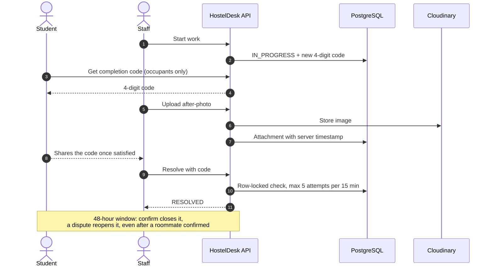
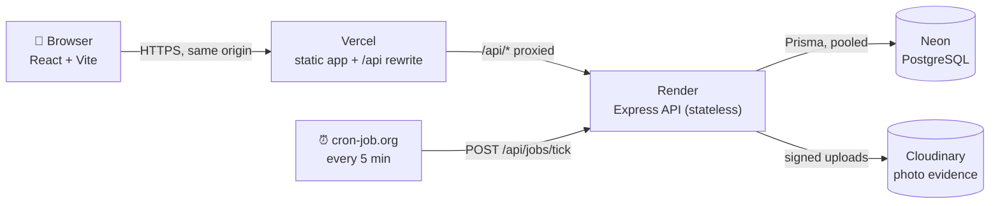
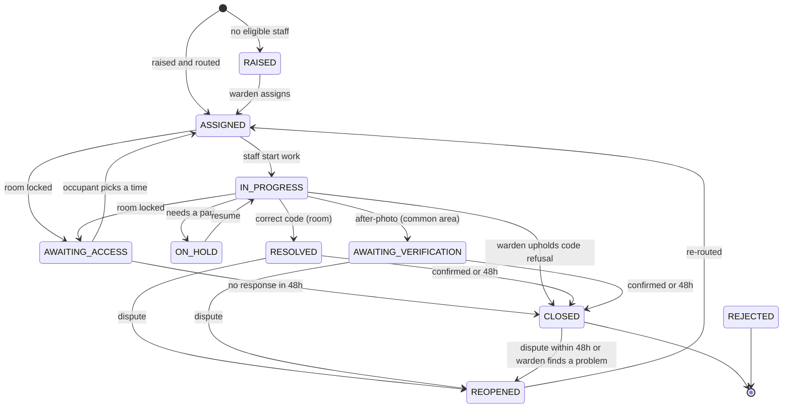
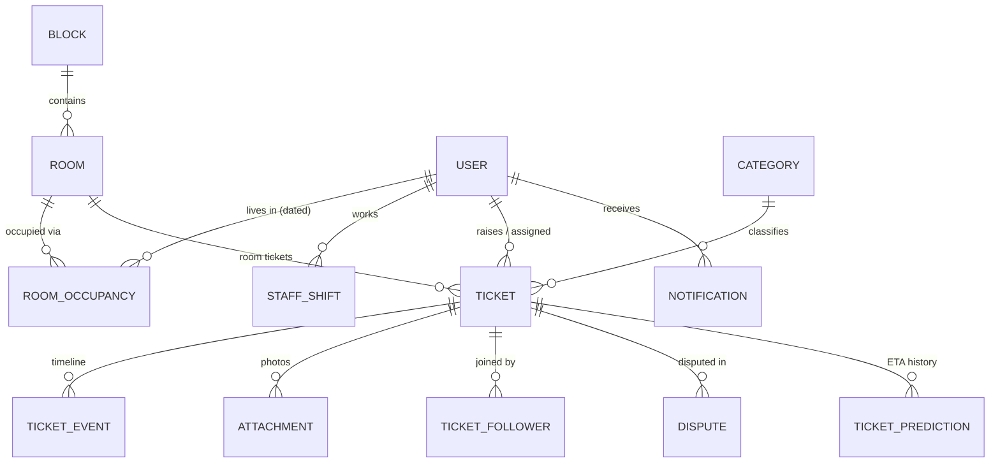

<div align="center">

# 🏠 HostelDesk

### The hostel complaint register, rebuilt as software that keeps its promises.

**Every complaint gets a predicted fix time. Staff can't mark a job done without proof.**

<br/>


<br/>

**[Live app](#-deployment)** · **[Demo accounts](#-demo-accounts)** · **[Architecture](docs/ARCHITECTURE.md)** · **[Deployment guide](docs/DEPLOYMENT.md)**

</div>

---

## 📑 Contents

1. [The problem](#-the-problem)
2. [Who it's for](#-who-its-for)
3. [The solution](#-the-solution)
4. [Core workflows](#-core-workflows)
5. [Features by role](#-features-by-role)
6. [How the ETA is predicted](#-how-the-eta-is-predicted)
7. [How completion is proven](#-how-completion-is-proven)
8. [Architecture](#-architecture)
9. [Tech stack and why](#-tech-stack-and-why)
10. [Getting started](#-getting-started)
11. [Environment variables](#-environment-variables)
12. [Deployment](#-deployment)
13. [Demo accounts](#-demo-accounts)
14. [Testing](#-testing)
15. [Security](#-security)
16. [Scalability](#-scalability)
17. [Honest notes and limitations](#-honest-notes-and-limitations)
18. [AI usage](#-ai-usage)

---

## 🧩 The problem

In my hostel, room and facility complaints are written into a **paper register** at the warden's desk. Once the entry is made, nobody can answer the questions that matter:

| Question | Paper register |
|---|---|
| Who is handling my complaint, and since when? | ❌ Unknown |
| When will it be fixed? | ❌ No idea, so students wait in their rooms |
| Was the job actually done? | ❌ Anyone can write "done" |
| Is this the same problem 15 other students already reported? | ❌ 15 separate entries |
| Which staff are reliable? Which rooms keep breaking? | ❌ No data at all |

## 👥 Who it's for

| Role | Needs |
|---|---|
| 🎓 **Students** | Report problems in seconds, know when they'll be fixed, confirm or dispute the fix |
| 🔧 **Maintenance staff** (electricians, plumbers, carpenters, network, housekeeping) | A clear, ordered queue on their phone; a quick way to prove a job is done |
| 🛡️ **Block wardens** | Oversight of their block: escalations, disputes, priorities |
| 🏛️ **Chief warden** | Campus-wide view, second-level escalations, staff performance |
| ⚙️ **Admin** | Rooms and occupancy, staff and shifts, categories and deadlines |

## 💡 The solution

| Paper register problem | What HostelDesk does |
|---|---|
| Nobody knows who has it | Each ticket is **routed automatically** to the staff member who can finish it earliest; every change is recorded in a timeline |
| No ETA | A **predicted completion range** ("likely by 5:30 PM, latest around 6:15 PM") with a plain-language *"Why this estimate?"* explanation |
| Fake "done" | A **4-digit completion code** only the room's occupants can see, plus photo evidence and a 48-hour dispute window |
| Duplicate entries | Same-room duplicates are blocked; common-area reports can be **joined** instead of repeated |
| No data | **Analytics**: deadline breaches, staff reliability scores, repeat-problem rooms, and prediction accuracy over time |
| Complaints forgotten | **Automatic escalation** to the warden, then the chief warden, when deadlines are missed |

## 🔄 Core workflows

**1. Raise → route → predict**
A student reports an issue for their room or a common area → the category sets the trade, priority and deadline → HostelDesk simulates every eligible staff member's schedule → the ticket goes to whoever finishes **earliest** → the student sees an ETA range.

**2. Fix → prove → confirm**
Staff start the job → a **completion code** appears on the occupants' phones → staff upload an after-photo and enter the code → the ticket is resolved → occupants confirm, or dispute within 48 hours (**a dispute always wins**).

**3. Report together, not twice**
A second student on the same floor reports the same washroom issue → HostelDesk shows the existing report → they **join** it and get every update, instead of creating a duplicate.

**4. Locked room**
Staff arrive and the room is locked → they upload a **door photo** → the deadline clock **pauses** → occupants choose "I'll be there in 15 min" or book a time slot → after a 2nd locked visit, a slot is required.

**5. Nothing slips through**
A deadline is missed → the block warden is alerted → still open 24 hours later → the chief warden is alerted. Resolved tickets with no response close automatically after 48 hours.

## ✨ Features by role

<details open>
<summary><b>🎓 Student</b></summary>

- Raise room or common-area complaints; priority comes from the category, not the student
- Room tickets are **shared by all current roommates**; moving out removes access automatically
- ETA range with a *"Why this estimate?"* breakdown and the history of past predictions
- Completion code card while work is in progress
- Confirm the fix, or dispute it within 48 hours with a reason
- Respond to a locked-room visit: 15-minute return or a time slot; report a false "room locked" claim
- In-app notifications, including friendly delay messages ("a more urgent issue was added ahead of yours")
</details>

<details>
<summary><b>🔧 Staff</b></summary>

- Mobile-first queue showing **planned start and finish times** for the day
- Start work, take after-photos with the phone camera, enter the completion code
- Report a locked room (door photo required), pause for parts, resume
- Escalate when an occupant refuses to give the code even though the job is done
</details>

<details>
<summary><b>🛡️ Warden and chief warden</b></summary>

- Block-scoped ticket table with filters; reassign, re-prioritise (reason required) or reject
- **Dispute queue** with all photos, server timestamps and the full timeline; uphold or reject
- Optional quality spot-checks on closed tickets
- Staff schedule viewer
- **Analytics**: breach rate, average resolution time, reliability scores, repeat-problem rooms, prediction-accuracy trend
</details>

<details>
<summary><b>⚙️ Admin</b></summary>

- Room browser; move students between rooms (max 2 occupants) or end an occupancy
- **CSV import** of students with a preview step and all-or-nothing apply
- Create and deactivate staff (open tickets are safely reassigned); weekly **shift editor**
- Edit categories: durations, deadlines, default priority
- Audit log of every admin action
- Demo time-travel controls (advance the clock to show escalations live)
</details>

## ⏳ How the ETA is predicted

No black-box ML. With tens to hundreds of tickets, a transparent formula is more accurate and can be explained in a sentence.

### Step 1: How long will the work take?

Start from the category's default duration, and move towards what similar past jobs actually took as evidence builds up:

```
estimate = (k × default + n × observed_median) / (k + n)        k = 5
```

Only **trustworthy** completions count (verified by completion code or confirmed by the student), and the median is used so one disastrous job can't skew it. **Worked example**, fan repair with a 40-minute default:

| Situation | n | Observed median | Estimate |
|---|---|---|---|
| No history yet | 0 | n/a | **40 min** |
| After 5 jobs | 5 | 70 min | (5×40 + 5×70) / 10 = **55 min** |
| After 45 jobs | 45 | 70 min | (5×40 + 45×70) / 50 = **67 min** |

An 80th-percentile estimate is computed the same way, which gives the "latest" end of the range.

### Step 2: When will this staff member get to it?

For each eligible staff member, HostelDesk **simulates their queue**: in-progress jobs first, then by priority (urgent → normal → low) and age, laid into their real **shift windows**, skipping lunch breaks, nights and days off. The ticket goes to whoever **finishes it earliest**, which is not the same as whoever has the fewest tickets.

**Worked example:** Monday 4:30 PM, a new 60-minute tap repair.

| Staff | Situation | Simulated finish |
|---|---|---|
| Ramesh | Works until 6 PM; an urgent 45-min job and an older 50-min job are ahead | Tuesday ~10:05 AM |
| Suresh | Off on Monday; empty queue | Tuesday 10:00 AM |
| **Anil** | Works until 6 PM; empty queue | **Monday 5:30 PM** ✅ |

Queues are re-simulated whenever something changes (new ticket, reassignment, priority change, job started) and every 5 minutes by a background job. If a student's ETA slips by more than 30 minutes, they are told why.

### Does it get better over time?

Every prediction is stored and compared with what actually happened. Error is measured in **working minutes** inside the staff member's shifts, because a 20-minute miss that crosses a night isn't a 15-hour error:

> Predicted Mon 5:50 PM, finished Tue 9:20 AM, shifts 9–1 and 2–6 → error = 10 min (Mon) + 20 min (Tue) = **30 working minutes**, not 930.

On the generated history, the weekly average error falls from **27.3 to 14.8 minutes** between the first and last two weeks (synthetic data; see [honest notes](#-honest-notes-and-limitations)).

## 🔐 How completion is proven



| Situation | How the job is verified |
|---|---|
| Room ticket, occupant present | Completion code (any current roommate can give it) + after-photo |
| Common-area ticket | After-photo → the reporter or anyone who joined confirms or disputes |
| Room locked | Door photo required; deadline paused; occupant books a return; false claims go to the warden |
| Occupant refuses the code | Staff raise a dispute → the warden decides from photos and timeline |
| Nobody responds | Auto-closes after 48 hours |

The code is generated with a cryptographic RNG, returned by **one endpoint only** (current occupants, while in progress), and guarded by a row-locked attempt counter so parallel guessing can't bypass the limit.

## 🧱 Architecture



| Module | Responsibility |
|---|---|
| `auth` | Login, httpOnly JWT cookie, role guards; room access looked up from occupancy **on every request** |
| `tickets` | Ticket lifecycle, central access rules, duplicate handling, comments, timeline |
| `tickets/stateMachine` | Every allowed status transition and who may perform it, as one tested table |
| `scheduling` | Shift calendar, duration estimator, queue simulator, routing, ETA recompute and delay alerts |
| `evidence` | Photo uploads (type, size and magic-byte checks), completion codes, resolve, confirm, dispute |
| `disputes` | Code-refusal and false-lock disputes, warden decisions |
| `jobs` | Deadline escalation, 48-hour auto-close, queue recompute; all idempotent |
| `analytics` | Scoped aggregate metrics, reliability score, prediction-accuracy trend |
| `admin` | Rooms and occupancy, CSV import, staff and shifts, categories, audit log |
| `lib/clock` | One source of "now"; supports a demo time offset stored in the database |

### Ticket lifecycle



Any open ticket can also be **rejected** by a warden with a reason. Transitions not in the table are refused with `409`. Status changes use conditional updates inside transactions, so two people acting at the same moment can't corrupt a ticket.

### Data model (simplified)



Occupancy has **from/to dates**, so "who lived in A-301 on 12 Oct" is a query, and a student who moves out loses access to the old room's tickets the same day. A deeper write-up of every algorithm and module is in **[docs/ARCHITECTURE.md](docs/ARCHITECTURE.md)**.

## 🧰 Tech stack and why

| Layer | Choice | Why this, not something else |
|---|---|---|
| Language | **TypeScript** (client and server) | One language end to end; types catch contract mismatches between API and UI |
| Frontend | **React 18 + Vite**, Tailwind CSS, TanStack Query, React Router, Recharts | Fast builds; server state, caching and polling handled by TanStack Query |
| Backend | **Node.js + Express** | Simple, well understood, enough for a stateless JSON API |
| Database | **PostgreSQL on Neon** | The data is relational (blocks → rooms → dated occupancy → tickets → events). Correctness features (state transitions, the dispute-wins rule, the code attempt limit) rely on **transactions, row locks, foreign keys and unique constraints**; medians come from `percentile_cont` |
| ORM | **Prisma** | Type-safe queries; migrations committed to git, so the schema's history is reviewable |
| Validation | **Zod** | Every request body and query validated before business logic runs |
| Photos | **Cloudinary** | Evidence must survive server restarts; free-tier hosts have no persistent disk |
| Background jobs | **External cron → `/api/jobs/tick`** | Render's free tier sleeps, so in-process timers are unreliable; external triggers also keep the server stateless for horizontal scaling |
| Hosting | **Vercel** (client) + **Render** (API) | Vercel forwards `/api/*` to Render, so the login cookie is **first-party** and works on Safari / iPhone |

## 🚀 Getting started

**Prerequisites:** Node.js 20+, a PostgreSQL database (a free [Neon](https://neon.tech) project works), and a [Cloudinary](https://cloudinary.com) account whose API key has the **Master Admin** role.

```bash
# 1. Clone
git clone https://github.com/Aditya2514/HostelDesk.git
cd HostelDesk

# 2. Server
cd server
cp .env.example .env              # then fill in real values (see below)
npm install
npx prisma migrate deploy         # create the schema
npx prisma db seed                # blocks, rooms, 150 students, staff + shifts, categories
npm run seed:history              # 200 synthetic past tickets so the estimator has data
npm run seed:demo                 # 6 [DEMO] tickets for a walkthrough (run this last)
npm run check:cloudinary          # optional: confirms photo uploads work
npm run dev                       # API on http://localhost:4000

# 3. Client (second terminal)
cd ../client
cp .env.example .env
npm install
npm run dev                       # app on http://localhost:5173
```

Open **http://localhost:5173** and use the demo account buttons on the login screen.

> ℹ️ Run smoke tests **before** `seed:demo`, not after: the demo tickets occupy room A-301, which the smoke tests also use.

## 🔑 Environment variables

**Server (`server/.env`)**

| Variable | Purpose | Example |
|---|---|---|
| `DATABASE_URL` | **Pooled** Postgres connection used by the app | `postgresql://…-pooler…/neondb?sslmode=require` |
| `DIRECT_URL` | **Direct** connection used only by migrations | `postgresql://…/neondb?sslmode=require` |
| `JWT_SECRET` | Signs session tokens (at least 16 characters; use 32+) | `openssl rand -hex 32` |
| `CLIENT_ORIGIN` | Allowed frontend origin for CORS | `http://localhost:5173` |
| `CLOUDINARY_CLOUD_NAME` | Cloudinary cloud name | `my-cloud` |
| `CLOUDINARY_API_KEY` | Cloudinary key (Master Admin role) | `123456789012345` |
| `CLOUDINARY_API_SECRET` | Cloudinary secret | *never commit this* |
| `JOBS_SECRET` | Required `x-jobs-secret` header for `/api/jobs/tick` | `openssl rand -hex 16` |
| `DEMO_MODE` | `true` enables the demo time-travel controls | `true` |
| `PORT` | API port | `4000` |
| `NODE_ENV` | `development` / `production` / `test` | `development` |

**Client (`client/.env`)**

| Variable | Purpose | Example |
|---|---|---|
| `VITE_API_URL` | API base URL. **Leave empty** locally (Vite proxy) and in production (Vercel rewrite) | `""` |
| `VITE_DEMO_MODE` | Shows the demo-account quick-login panel | `true` |

## 🌐 Deployment

| Component | URL |
|---|---|
| **Live app** | `<VERCEL_URL>` |
| API (direct) | `<RENDER_URL>` |
| Scheduled jobs | cron-job.org → `POST <RENDER_URL>/api/jobs/tick` every 5 minutes (also keeps the free instance awake) |

Step-by-step instructions (Neon branches, Render build command, Vercel rewrite, cron, seeding production) are in **[docs/DEPLOYMENT.md](docs/DEPLOYMENT.md)**. After deploying, verify the live site with:

```bash
cd server && npm run smoke:prod -- --base=<VERCEL_URL>
```

## 👤 Demo accounts

All passwords: **`Demo@1234`**

| Role | Email | Try this |
|---|---|---|
| 🎓 Student (room A-301) | `student1@hosteldesk.dev` | Raise a ticket, read its ETA explanation, view the completion code |
| 🎓 Roommate (A-301) | `student2@hosteldesk.dev` | See the shared room ticket; dispute a fix your roommate confirmed |
| 🔧 Electrician | `electrician1@hosteldesk.dev` | Planned day, start work, resolve with a code |
| 🔧 Plumber | `plumber1@hosteldesk.dev` | Photo evidence, room-locked flow |
| 🛡️ Warden, Block A | `warden.a@hosteldesk.dev` | Disputes, reassign, analytics for Block A |
| 🏛️ Chief warden | `chief@hosteldesk.dev` | All blocks, second-level escalations |
| ⚙️ Admin | `admin@hosteldesk.dev` | Room moves, CSV import, shifts, categories, time-travel |

`npm run seed:demo` prints the six `[DEMO]` tickets it creates (fresh ETA, joined common-area report, locked room, resolved awaiting confirmation, ticket about to breach its deadline, open dispute) and which account to use for each.

## 🧪 Testing

**Unit tests** (Vitest): **201 tests in 27 files**, covering the state machine, access rules, estimator (exact numbers above), shift arithmetic, queue simulator (including the Ramesh/Suresh/Anil example), completion codes and the attempt lockout, confirm/dispute, locked rooms, SLA pausing, escalation, auto-close, analytics scoring and scoping, and admin permissions.

```bash
cd server && npm test
```

**Smoke tests** run against a **real database** over HTTP, one per build phase:

| Script | What it proves end to end |
|---|---|
| `npm run smoke:phase2` | Ticket creation, roommate access, duplicate blocking and joining, permissions, notifications |
| `npm run smoke:phase3` | Routing to the earliest finisher, ETA explanation without data leaks, delay alerts, idempotent ticks |
| `npm run smoke:phase4` | Completion code privacy, **5-attempt lockout**, real Cloudinary uploads, dispute-wins, locked rooms, warden decisions |
| `npm run smoke:phase5` | Two-level escalation (warden, then chief warden 24h later), 48-hour auto-close of resolved and unreachable tickets |
| `npm run smoke:phase6` | Analytics scope, accuracy trend, reliability scores, room moves, CSV import, shifts, staff deactivation, audit log |
| `npm run smoke:prod` | The deployed site: health, every role's login through the same-site cookie, a full ticket round-trip |

## 🔒 Security

- **Passwords** hashed with bcrypt; generated temporary passwords are shown once and stored only as hashes
- **Sessions** in `httpOnly`, `SameSite=Lax`, `Secure` (production) cookies; no tokens in `localStorage`
- **Authorization on the server** for every endpoint; unauthorized ticket lookups return `404` so IDs can't be probed
- **Explicit field selection** on ticket responses, with a test that the completion code is never selected
- **Rate limits:** 10 login attempts per 15 minutes per email; 5 wrong completion codes lock that ticket for 15 minutes
- **Input validation** with Zod; uploads checked by size, count and file signature (magic bytes)
- **Audit log** for every admin action; full event timeline for every ticket
- **No secrets in git:** only `.env.example` files are committed

## 📈 Scalability

Expected load for a whole campus (~2,000 students, ~60 tickets/day) is tiny for PostgreSQL. The design keeps the door open anyway:

| What would break first | Path forward |
|---|---|
| Free-tier sleeping | Paid instance; no code changes |
| Database connections with many instances | Already using Neon's pooled connection string |
| Analytics over years of history | Nightly summary tables or materialized views |
| Multiple colleges | Add `campusId` to core tables and scope every query |
| Server CPU | More instances behind a load balancer. Possible because the server is **stateless** and background jobs are **externally triggered and idempotent** |

## 📝 Honest notes and limitations

- **The historical data is synthetic.** `seed:history` generates 200 past tickets with a fixed random seed, realistic durations, staff speed differences and deadline breaches, so the estimator, analytics and charts have something to work with. Real hostels would accumulate this data through use.
- **Notifications are in-app only** (polled every 30 seconds); no SMS or email.
- **Shifts are in IST only**, and a shift can't cross midnight.
- **Photo evidence is strong but not absolute:** a browser can't force a live camera capture on every device, so photos support decisions rather than prove them on their own. The completion code is the primary proof.
- **Free-tier hosting** may add a short delay on the first request after inactivity; the 5-minute cron keeps it warm.

## 🤖 AI usage

AI tools were used throughout this project: an AI assistant to discuss and refine the design, and an AI coding agent to generate much of the code, tests and documentation.

- **The problem and the core idea are my own:** my hostel's paper register, and the requirements that the app should predict fix times and stop staff marking unfinished work as done.
- **The design was worked out iteratively in discussion with AI**: the estimator formula, completion codes, the dispute-wins rule, the locked-room flow and the working-minute accuracy metric. Every rule was reviewed, adjusted (for example, room-level tickets shared by roommates, and no entry into locked rooms) and accepted by me before it was built.
- **Every phase was verified, not trusted:** with unit tests, real-database smoke tests and code review. That process caught several AI-introduced problems, including a transaction rollback that silently disabled the completion-code lockout, a fallback that faked photo uploads, and test output in reports that didn't match what the scripts actually printed. All were fixed and the smoke tests now check for them.

---

<div align="center">

Built by **Aditya Singh** · End-term software project, October 2026

</div>
