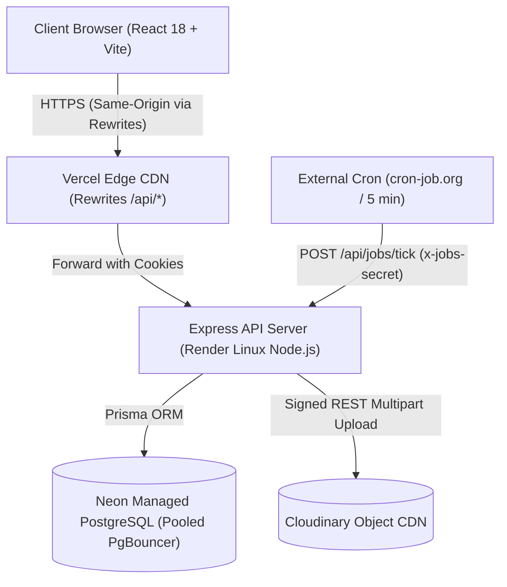
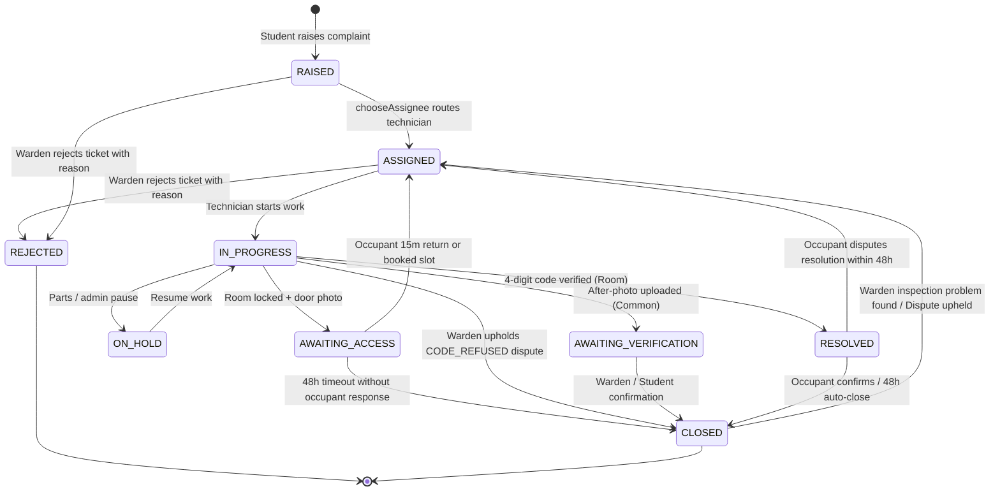

# HostelDesk — System Architecture & Algorithmic Design

This document provides deep technical reference for HostelDesk's state machines, queuing algorithms, evidence lifecycle, and execution patterns.

---

## 1. System Component Topology

---

## 2. Ticket State Machine Specification

HostelDesk enforces a strict deterministic finite-state transition graph. Illegal transitions trigger `400 INVALID_STATUS_TRANSITION` on the server.

### Transition Table

| Current Status | Allowed Target Statuses | Trigger / Prerequisite |
|---|---|---|
| `RAISED` | `ASSIGNED`, `REJECTED` | System routing or Warden rejection |
| `ASSIGNED` | `IN_PROGRESS`, `REJECTED`, `ASSIGNED` (reassign) | Technician starts work or re-routed |
| `IN_PROGRESS` | `RESOLVED`, `AWAITING_ACCESS`, `ON_HOLD`, `AWAITING_VERIFICATION`, `CLOSED` | Code match, Door photo, Parts pause, Warden dispute decision |
| `AWAITING_ACCESS` | `ASSIGNED`, `CLOSED` | 15-min quick return, Slot booking, or 48h access expiration |
| `ON_HOLD` | `IN_PROGRESS` | Technician resumes with parts |
| `AWAITING_VERIFICATION` | `CLOSED`, `ASSIGNED` | Confirmation or Warden review |
| `RESOLVED` | `CLOSED`, `ASSIGNED` | Occupant confirmation, 48h timeout, or Occupant dispute |
| `CLOSED` | `ASSIGNED` | Roommate dispute within 48h window or Warden problem flag |
| `REJECTED` | *(Terminal)* | Irreversible; reason recorded in event log |

---

## 3. The ETA Prediction Engine

HostelDesk predicts completion times using a 2-stage pipeline: **Empirical Duration Blending** followed by **Discrete Schedule Simulation**.

### Stage 1: Blended Duration Estimator

For any ticket category, the duration estimator calculates P50 and P80 completion durations by blending default estimates with real historical observations from that block and hostel:

- Block weight: $w_{\text{block}} = n_{\text{block}} / (n_{\text{block}} + 5)$
- Hostel weight: $w_{\text{hostel}} = n_{\text{hostel}} / (n_{\text{hostel}} + 10)$
- Blended Estimate: $\text{Est}_{\text{P50}} = (1 - w) \cdot \text{DefaultDuration} + w \cdot \text{ObservedMedian}$

#### Worked Example
- Default duration for ceiling fan repair = **40 minutes**.
- **First week:** $n = 0$ historical observations $\implies w = 0 \implies \mathbf{40\text{ min}}$.
- **Second week:** $n = 5$ observations with observed median of $70\text{ min}$:
  $$w = \frac{5}{5 + 5} = 0.5 \implies 0.5(40) + 0.5(70) = \mathbf{55\text{ min}}$$
- **Fourth week:** $n = 20$ observations with observed median of $74\text{ min}$:
  $$w = \frac{20}{20 + 5} = 0.8 \implies 0.2(40) + 0.8(74) = \mathbf{67.2\text{ min}} \approx \mathbf{67\text{ min}}$$

---

### Stage 2: Schedule Simulation (Queue Laydown)

Each technician's queue is simulated sequentially in priority order (`URGENT` > `NORMAL` > `LOW`, then by creation timestamp).

#### The Simulation Algorithm:
1. Initialize simulation clock: $T = \max(\text{clock.now()}, \text{nextShiftStart})$.
2. If technician is currently working a job, deduct remaining active duration.
3. For each queued job:
   - Walk through the technician's configured working windows (`staff_shifts`), skipping nights and breaks.
   - Advance clock $T$ until the job's duration has accumulated entirely within active working minutes.
   - The timestamp when duration finishes is the ticket's `predictedP50At`.
4. **Technician Routing Rule:** A new ticket is assigned to the eligible technician whose simulated queue finishes that ticket **earliest**.

#### Worked Example: Assigning a 60-min Normal Electrical Ticket at 16:30 IST
Technician shifts: 09:00–18:00 IST (lunch break 13:00–14:00).
- **Ramesh (Electrician):** Currently free. Finishes 16:30 + 60m = **17:30 IST Today**.
- **Suresh (Electrician):** Has one 45-min urgent ticket in progress. Finishes at 17:15, then starts new ticket: 45 min today (until 18:00 shift end) + 15 min next morning (09:15) = **09:15 IST Tomorrow**.
- **Anil (Electrician):** Queue busy with 3 jobs until 14:00 tomorrow = **15:00 IST Tomorrow**.

$\implies$ **Ramesh is automatically chosen** because 17:30 IST Today is the earliest finish time.

---

### Stage 3: Measuring Prediction Accuracy (Shift-Aware Working Minutes)

Prediction error is strictly measured in **working minutes** within that technician's active shift windows:
$$\text{Prediction Error} = \text{workingMinutesBetween}(\min(\text{predictedP50At}, \text{resolvedAt}), \max(\text{predictedP50At}, \text{resolvedAt}), \text{staffShifts})$$

#### Why Shift-Aware Working Time is Crucial
Standard wall-clock calculation $|\text{predicted} - \text{resolved}|$ introduces severe distortion whenever a job spans a meal break, overnight off-hours, or a rest day.

- **Worked Example:**
  - Staff shifts: 09:00–13:00 and 14:00–18:00 IST (Mon–Fri).
  - Predicted finish: Monday 17:50 IST.
  - Actual finish: Tuesday 09:20 IST.
  - **Wall-clock difference:** 15 hours 30 minutes = **930 minutes** (falsely inflating error by counting 15 idle non-working hours).
  - **HostelDesk Shift-Aware Error:** 10 minutes on Monday (17:50–18:00) + 20 minutes on Tuesday (09:00–09:20) = **30 working minutes**.

This metric is evaluated in Node over window-bounded prediction/resolution pairs fetched in a single indexed SQL query, ensuring exact consistency between the scheduler simulation and historical accuracy analytics.

---

## 4. Evidence & Dispute Model

- **Room Tickets:** Completed exclusively via a cryptographically random 4-digit code shown only to verified room occupants.
  - **Wrong code lockout:** 5 consecutive failed attempts lock the ticket for 15 minutes. All events recorded in `ticket_events`.
- **Common Area Tickets:** Require a verifiable post-repair photograph uploaded directly to Cloudinary via signed multipart payload.
- **Dispute Always Wins Rule:** If Roommate A clicks "Confirm Resolved" but Roommate B clicks "Dispute" within the 48-hour window, the dispute immediately overrides confirmation and returns the ticket to `ASSIGNED` with incremented `reopenCount`.
- **Locked Room Protocol:**
  - Visit 1: Mandatory door photo $\implies$ Occupant notified with options: (A) Quick 15-min return or (B) Scheduled 30-min shift slot.
  - Visit 2: Quick return disabled; occupant **must** select a 30-min shift slot.
  - False claim protection: Occupants can dispute false lock claims directly to the Warden.

---

## 5. Background Automation Jobs (`/api/jobs/tick`)

Triggered externally every 5 minutes by cron:
1. **Auto-Escalation:** Scans all open tickets where `clock.now() > dueAt` (accounting for paused minutes):
   - Level 0 $\to$ 1: Notifies Block Warden.
   - Level 1 $\to$ 2 (after 24 hours overdue): Notifies Chief Warden.
2. **Auto-Close:** Automatically transitions tickets in `RESOLVED` / `AWAITING_VERIFICATION` to `CLOSED` after 48 hours without disputes.
3. **Queue Health & ETAs:** Refreshes active predictions for any overdue shifts.
4. **Strict Idempotency:** Running `/api/jobs/tick` repeatedly yields zero duplicate transitions or notifications.
