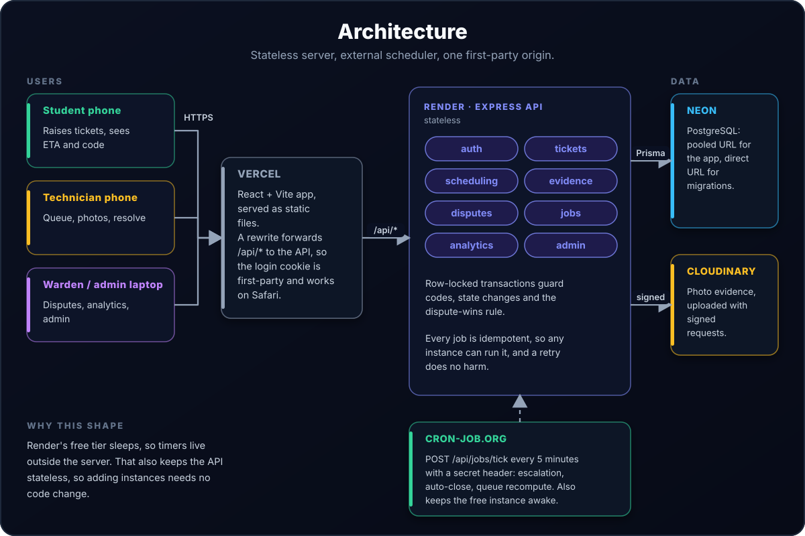
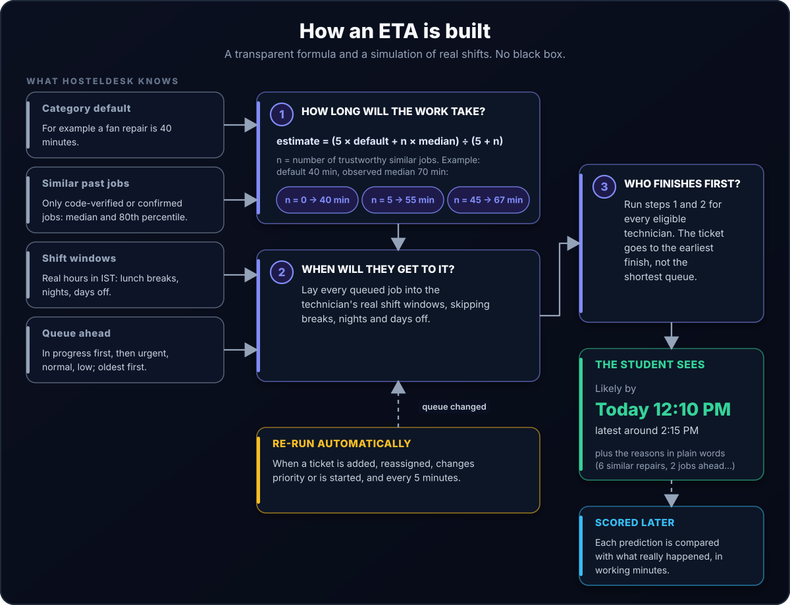
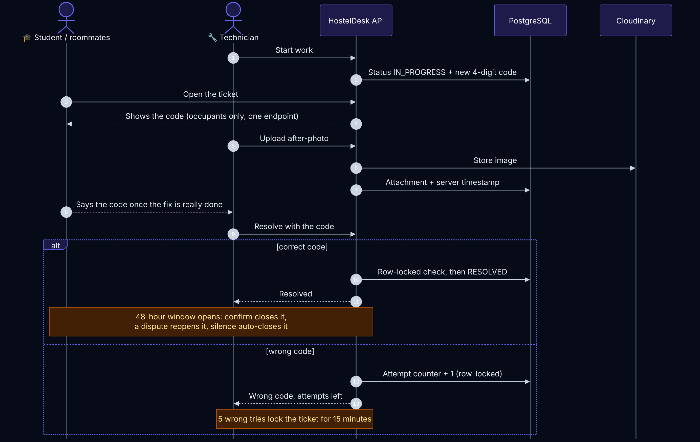
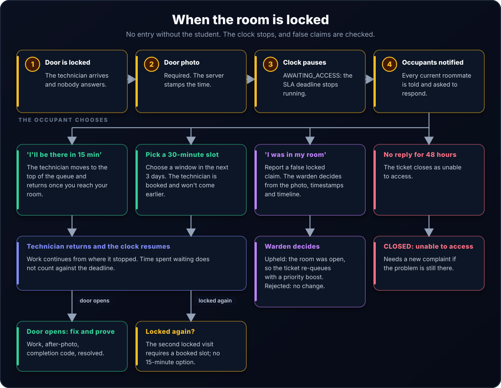

# HostelDesk — System Architecture & Algorithmic Design

This document provides deep technical reference for HostelDesk's state machine, queuing algorithms, evidence lifecycle, and execution patterns. The diagrams are animated: highlights step through each part in the order a request or ticket moves through it. (Diagram sources: [`docs/diagrams/src`](diagrams/src).)

| | |
|---|---|
| [1. System component topology](#1-system-component-topology) | [4. Evidence & dispute model](#4-evidence--dispute-model) |
| [2. Ticket state machine](#2-ticket-state-machine-specification) | [5. Background automation jobs](#5-background-automation-jobs-apijobstick) |
| [3. The ETA prediction engine](#3-the-eta-prediction-engine) | |

---

## 1. System Component Topology

| Component | Role |
|---|---|
| Client browser (React 18 + Vite) | Single-page app, served as static files from Vercel |
| Vercel | Rewrites `/api/*` to the API, so the login cookie is first-party (works on Safari / iPhone) |
| Express API (Render, Node.js) | Stateless JSON API; all state lives in the database |
| Neon PostgreSQL | Pooled connection (PgBouncer) for the app, direct connection for migrations |
| Cloudinary | Photo evidence, uploaded with signed multipart requests |
| External cron (cron-job.org, every 5 min) | `POST /api/jobs/tick` with an `x-jobs-secret` header |

---

## 2. Ticket State Machine Specification

HostelDesk enforces a deterministic transition table (`server/src/modules/tickets/stateMachine.ts`). A transition that is not in the table is refused with `409 INVALID_TRANSITION`; a role that is not allowed to perform a listed transition gets `403 FORBIDDEN_TRANSITION`; transitions that require a reason (hold, reopen, reject) fail with `400 REASON_REQUIRED` when none is given.

The highlighted path shows the normal case: raised and routed, assigned, work started, resolved with the code, confirmed or auto-closed after 48 hours.

### Transition Table

| Current Status | Allowed Target Statuses | Who / Prerequisite |
|---|---|---|
| *(new ticket)* | `ASSIGNED`, `RAISED` | System routing, or no eligible staff available |
| `RAISED` | `ASSIGNED`, `REJECTED` | Warden / admin / system assigns; warden rejects (reason required) |
| `ASSIGNED` | `IN_PROGRESS`, `AWAITING_ACCESS`, `ASSIGNED` (reassign), `REJECTED` | Staff start work or find the room locked; warden reassigns or rejects |
| `IN_PROGRESS` | `RESOLVED`, `AWAITING_VERIFICATION`, `AWAITING_ACCESS`, `ON_HOLD`, `CLOSED`, `ASSIGNED`, `REJECTED` | Staff: code match (room), after-photo (common area), door photo, pause for parts (reason required). Warden: uphold a code-refusal dispute (`CLOSED`), reassign, reject |
| `AWAITING_ACCESS` | `ASSIGNED`, `CLOSED`, `REJECTED` | Occupant picks 15-min return or a slot (`ASSIGNED`); system closes after 48 h without response |
| `ON_HOLD` | `IN_PROGRESS`, `ASSIGNED`, `REJECTED` | Staff resume with parts; warden reassigns or rejects |
| `RESOLVED` | `CLOSED`, `REOPENED`, `REJECTED` | Occupant confirms or 48 h auto-close; occupant disputes (reason required) |
| `AWAITING_VERIFICATION` | `CLOSED`, `REOPENED`, `REJECTED` | Reporter or follower confirms (or 48 h auto-close); reporter disputes |
| `CLOSED` | `REOPENED` | Student dispute inside the 48 h window, or a warden quality check finds a problem (reason required) |
| `REOPENED` | `ASSIGNED`, `REJECTED` | System re-routes to a technician; warden may reassign or reject |
| `REJECTED` | *(terminal)* | Irreversible; the reason is recorded in the event log |

> **Dispute wins.** A dispute moves the ticket to `REOPENED` and increments `reopenCount`; it is then re-routed straight back to `ASSIGNED` when a technician is available. A dispute overrides any confirmation, even one a roommate gave earlier.

Status changes use conditional updates inside transactions (`SELECT … FOR UPDATE` where it matters), so two people acting at the same moment cannot corrupt a ticket.

---

## 3. The ETA Prediction Engine

HostelDesk predicts completion times using a 2-stage pipeline: **Empirical Duration Blending** followed by **Discrete Schedule Simulation**.

### Stage 1: Blended Duration Estimator

For any ticket category, the duration estimator calculates P50 and P80 completion durations by blending default estimates with real historical observations from that block and hostel:

- Weight of the evidence: $w = n / (n + k)$ with $k = 5$, i.e. the category default counts as much as 5 real observations. The same $k$ is used whether the similar tickets come from the same block (used when there are at least 5) or the whole hostel.
- Blended estimate: $\text{Est}_{\text{P50}} = (1 - w) \cdot \text{DefaultDuration} + w \cdot \text{ObservedMedian}$, equivalently $(k \cdot \text{Default} + n \cdot \text{Median}) / (k + n)$.
- The P80 estimate blends $1.5 \times \text{Default}$ with the observed 80th percentile in the same way, and is never below P50.

#### Worked Example
- Default duration for ceiling fan repair = **40 minutes**.
- **First week:** $n = 0$ historical observations $\implies w = 0 \implies \mathbf{40\text{ min}}$.
- **Second week:** $n = 5$ observations with observed median of $70\text{ min}$:
  $$w = \frac{5}{5 + 5} = 0.5 \implies 0.5(40) + 0.5(70) = \mathbf{55\text{ min}}$$
- **Later:** $n = 45$ observations, observed median still $70\text{ min}$:
  $$w = \frac{45}{45 + 5} = 0.9 \implies 0.1(40) + 0.9(70) = \mathbf{67\text{ min}}$$
  (These exact numbers are asserted in `server/tests/estimator.test.ts`.)

---

### Stage 2: Schedule Simulation (Queue Laydown)

Each technician's queue is simulated sequentially: in-progress jobs first, then by priority (`URGENT` > `NORMAL` > `LOW`), then by creation timestamp.

#### The Simulation Algorithm:
1. Initialize simulation clock: $T = \max(\text{clock.now()}, \text{nextShiftStart})$.
2. If technician is currently working a job, deduct remaining active duration.
3. For each queued job:
   - Walk through the technician's configured working windows (`staff_shifts`), skipping nights and breaks.
   - Advance clock $T$ until the job's duration has accumulated entirely within active working minutes.
   - The timestamp when duration finishes is the ticket's `predictedP50At`.
4. **Technician Routing Rule:** A new ticket is assigned to the eligible technician whose simulated queue finishes that ticket **earliest**.

#### Worked Example: Assigning a 60-min Normal Tap Repair at Monday 16:30 IST
Shifts: 09:00–13:00 and 14:00–18:00 IST.

- **Ramesh:** Works until 18:00; an urgent 45-min job and an older normal 50-min job are ahead. Urgent job 16:30–17:15; the 50-min job runs 17:15–18:00 and finishes at 09:05 Tuesday; the new job then finishes at **10:05 Tuesday**.
- **Suresh:** Off on Monday, empty queue. Starts 09:00 Tuesday, finishes **10:00 Tuesday**.
- **Anil:** Works until 18:00, empty queue. Starts now, finishes **17:30 Monday**.

$\implies$ **Anil is chosen**: earliest finish, not fewest tickets. This exact case is asserted in `server/tests/simulator.test.ts`.

---

### Stage 3: Measuring Prediction Accuracy (Shift-Aware Working Minutes)

Prediction error is strictly measured in **working minutes** within that technician's active shift windows:
$$\text{Prediction Error} = \text{workingMinutesBetween}(\min(\text{predictedP50At}, \text{resolvedAt}), \max(\text{predictedP50At}, \text{resolvedAt}), \text{staffShifts})$$

#### Why Shift-Aware Working Time is Crucial
Standard wall-clock calculation $|\text{predicted} - \text{resolved}|$ introduces severe distortion whenever a job spans a meal break, overnight off-hours, or a rest day.

- **Worked Example:**
  - Staff shifts: 09:00–13:00 and 14:00–18:00 IST (Mon–Fri).
  - Predicted finish: Monday 17:50 IST.
  - Actual finish: Tuesday 09:20 IST.
  - **Wall-clock difference:** 15 hours 30 minutes = **930 minutes** (falsely inflating error by counting 15 idle non-working hours).
  - **HostelDesk Shift-Aware Error:** 10 minutes on Monday (17:50–18:00) + 20 minutes on Tuesday (09:00–09:20) = **30 working minutes**.

This metric is evaluated in Node over window-bounded prediction/resolution pairs fetched in a single indexed SQL query, ensuring exact consistency between the scheduler simulation and historical accuracy analytics.

---

## 4. Evidence & Dispute Model

- **Room Tickets:** Completed exclusively via a cryptographically random 4-digit code shown only to verified room occupants.
  - **Wrong code lockout:** 5 consecutive failed attempts lock the ticket for 15 minutes. All events recorded in `ticket_events`.
- **Common Area Tickets:** Require a verifiable post-repair photograph uploaded directly to Cloudinary via signed multipart payload.
- **Dispute Always Wins Rule:** If Roommate A clicks "Confirm Resolved" but Roommate B clicks "Dispute" within the 48-hour window, the dispute immediately overrides confirmation: the ticket becomes `REOPENED` with an incremented `reopenCount` and is re-routed to `ASSIGNED`.
- **Locked Room Protocol:**
  - Visit 1: Mandatory door photo $\implies$ Occupant notified with options: (A) Quick 15-min return or (B) Scheduled 30-min shift slot.
  - Visit 2: Quick return disabled; occupant **must** select a 30-min shift slot.
  - False claim protection: Occupants can dispute false lock claims directly to the Warden.

---

## 5. Background Automation Jobs (`/api/jobs/tick`)

Triggered externally every 5 minutes by cron:

1. **Auto-Escalation:** Scans all open tickets where `clock.now() > dueAt` (accounting for paused minutes):
   - Level 0 $\to$ 1: Notifies Block Warden.
   - Level 1 $\to$ 2 (24 hours after the Level 1 escalation, if still open): Notifies Chief Warden.
2. **Auto-Close:** Automatically transitions tickets in `RESOLVED` / `AWAITING_VERIFICATION` to `CLOSED` after 48 hours without disputes.
3. **Queue Health & ETAs:** Refreshes active predictions for any overdue shifts.
4. **Strict Idempotency:** Running `/api/jobs/tick` repeatedly yields zero duplicate transitions or notifications.
